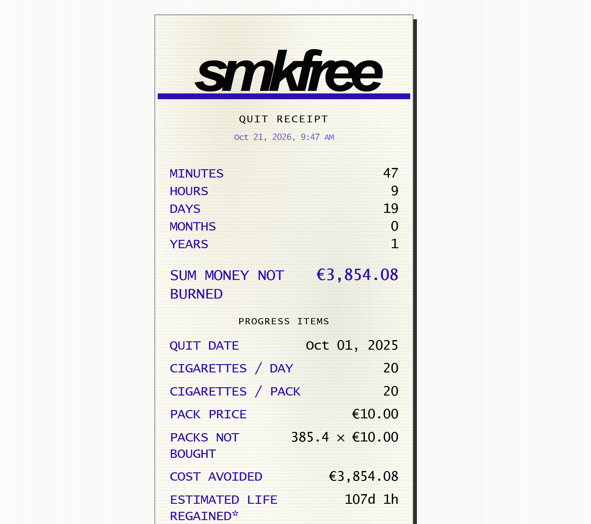

# SMKFREE

SMKFREE is a privacy-first smoke-free tracker that turns your progress into a shareable receipt.

[Open the live app](https://moritz249.github.io/smkfree/) · [Privacy and legal notes](legal.html)



*Example receipt generated with sample data.*

## What it does

Use the guided setup to track progress from cigarettes, roll-your-own tobacco, or vaping. SMKFREE turns your entries into a receipt showing time away, estimated money not spent, and other progress totals. It can also estimate cigarettes or roll-ups avoided. For cigarettes, it shows a population-level life-expectancy estimate; this is not an individual prediction.

- Create a receipt you can share or download as an image.
- Choose a receipt color and view optional health milestones.
- Install the app on a phone or desktop as a progressive web app (PWA).
- Continue using cached app files offline after the first successful load.

The totals are estimates based on the information you enter. Health milestones and population-level life-expectancy estimates are simplified, sourced estimates for motivation, not medical advice. See [Privacy and legal notes](legal.html) for sources and limitations.

## Privacy

Your entries and preferences are stored in your browser. The app has no account system, application backend, analytics, or tracking scripts. GitHub Pages may still process standard technical access data to host and secure the site. See [Privacy and legal notes](legal.html) for details.

## Run locally

SMKFREE has no build step or package dependencies. To run it from a local web server, use Python 3:

```bash
git clone https://github.com/moritz249/smkfree.git
cd smkfree
python -m http.server 8000
```

On Windows, `py -m http.server 8000` may be used instead. Then open [http://localhost:8000](http://localhost:8000) in your browser.

## Tests

Run the dependency-free calculation tests with Node.js 20 or newer:

```bash
npm test
```

## Deploy with GitHub Pages

The repository is a static site and can be served directly from its root. In the repository's **Settings → Pages**, choose the branch you want to publish and select `/(root)`. No build command is required.

## Project structure

```text
.
├── .gitignore              Ignore OS files, local settings, and generated output
├── .nojekyll               Keep GitHub Pages from applying Jekyll processing
├── README.md               Project overview and setup
├── assets/                 Icons, screenshots, QR code, and receipt image exporter
├── app.js                  UI, storage, and sharing
├── app-core.js             Pure calculations and input validation
├── package.json            Dependency-free Node test command
├── tests/                  Calculation regression tests
├── index.html              Main app
├── install.html            PWA installation instructions
├── legal.html              Privacy notes and estimate disclaimers
├── manifest.webmanifest    PWA metadata
├── styles.css              App and receipt styles
└── sw.js                   Service worker and offline asset cache
```

## Built with

- HTML, CSS, and vanilla JavaScript
- Browser `localStorage`, Web Share, and service worker APIs
- [html2canvas](https://github.com/niklasvh/html2canvas) for receipt image export
