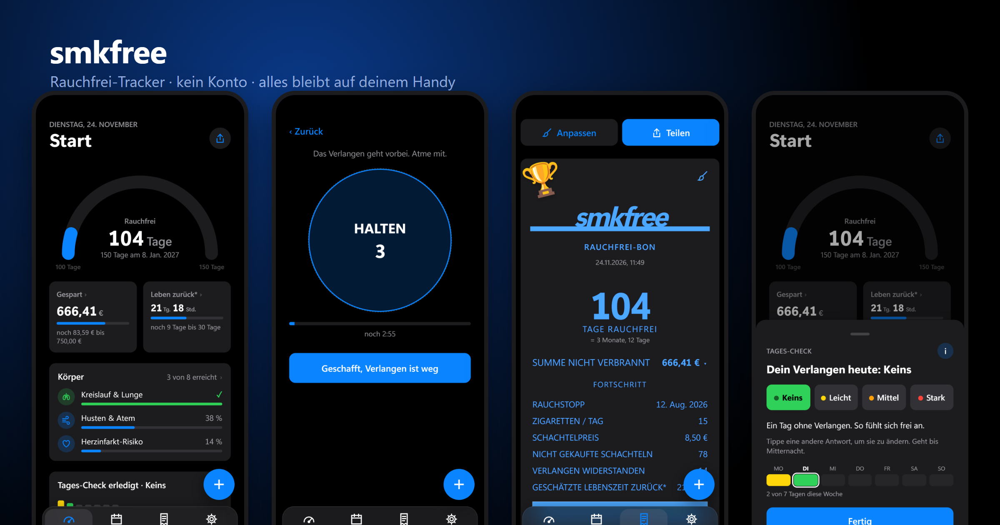
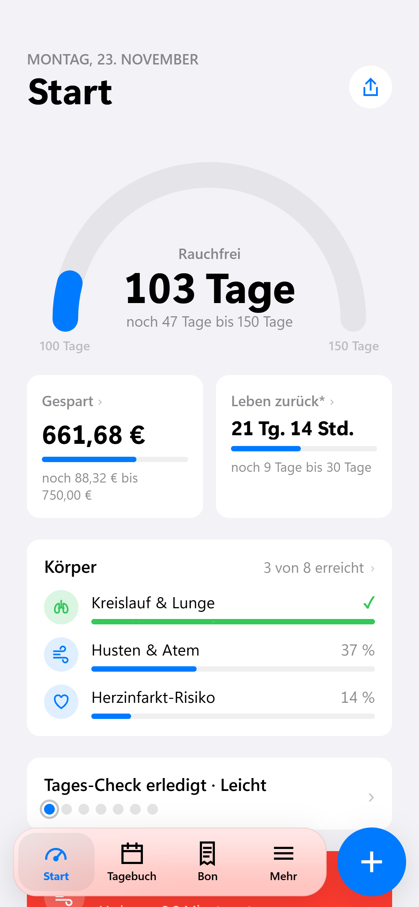
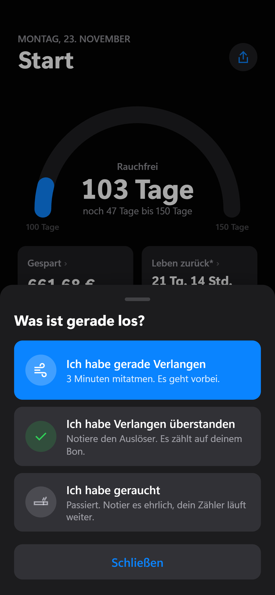
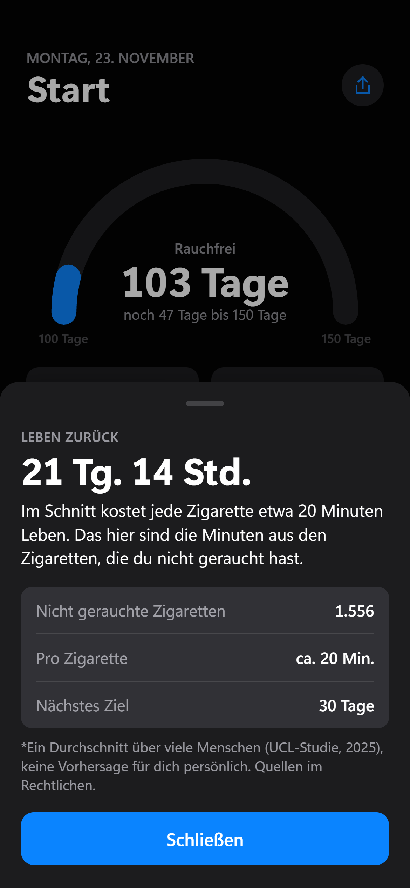
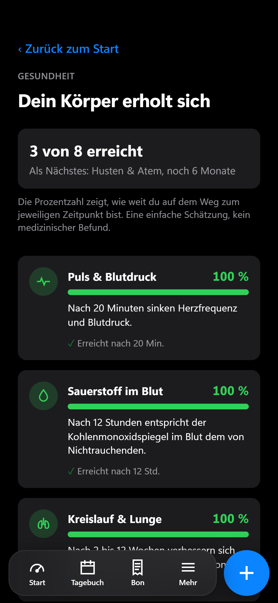

# SMKFREE

SMKFREE is a privacy-first smoke-free tracker that turns your progress into a shareable receipt.

[Open the live app](https://moritz249.github.io/smkfree/) · [Privacy and legal notes](legal.html)



<p>
  
  
  
  
</p>

*Screenshots with sample data (103 days smoke-free). Regenerate with `npm run serve`, then `npm run screenshots`.*

## What it does

Use the guided setup to track progress from cigarettes, roll-your-own tobacco, or vaping. SMKFREE turns your entries into a receipt showing time away, estimated money not spent, and other progress totals. It can also estimate cigarettes or roll-ups avoided. For cigarettes, it shows a population-level life-expectancy estimate; this is not an individual prediction.

- Create a receipt you can share or download as an image.
- Choose a receipt color and view optional health milestones.
- Install the app on a phone or desktop as a progressive web app (PWA).
- Continue using cached app files offline after the first successful load.

The totals are estimates based on the information you enter. Health milestones and population-level life-expectancy estimates are simplified, sourced estimates for motivation, not medical advice. See [Privacy and legal notes](legal.html) for sources and limitations.

## Privacy

Your entries and preferences are stored in your browser. The app has no account system, application backend, analytics, or tracking scripts. GitHub Pages may still process standard technical access data to host and secure the site. See [Privacy and legal notes](legal.html) for details.

## Run locally

The website has no build step. To run it from a local web server, use Python 3 (or `npm run serve` with Node.js):

```bash
git clone https://github.com/moritz249/smkfree.git
cd smkfree
python -m http.server 8000
```

On Windows, `py -m http.server 8000` may be used instead. Then open [http://localhost:8000](http://localhost:8000) in your browser.

## Tests

Run the dependency-free calculation tests with Node.js 20 or newer:

```bash
npm test
```

## Deploy with GitHub Pages

The repository is a static site and can be served directly from its root. In the repository's **Settings → Pages**, choose the branch you want to publish and select `/(root)`. No build command is required. The `ios/`, `android/`, `docs/` and `resources/` folders are ignored by the website.

## Native apps (iOS and Android)

The same web code ships as a native app through [Capacitor](https://capacitorjs.com). In the app it also gets
local notifications, haptics, the native share sheet, and storage that iOS cannot evict.

```bash
npm install
npm run sync          # copies the site to www/ and updates ios/ and android/
npx cap open ios      # Xcode (macOS)
npx cap open android  # Android Studio (Windows, macOS, Linux)
```

Step-by-step guides: [docs/IOS.md](docs/IOS.md) · [docs/ANDROID.md](docs/ANDROID.md) · open work: [docs/BACKLOG.md](docs/BACKLOG.md)

## Languages

English and German, detected from the device and switchable in the app (EN/DE). Texts live in `i18n.js`:
the English text is the key, and each language is one dictionary. `npm test` fails if a visible string has no translation.

## Project structure

```text
.
├── app.js                  UI, storage, sharing, onboarding, goal, reminders, craving SOS
├── app-core.js             Pure calculations, savings goal and reminder planning (tested)
├── native.js               Capacitor bridge with web fallbacks (haptics, share, notifications)
├── i18n.js                 Translations and locale formatting
├── index.html / styles.css Main app and receipt styles
├── legal.html, install.html
├── manifest.webmanifest, sw.js   PWA metadata and offline cache
├── assets/                 Icons, QR code, html2canvas
├── resources/              Source images for native icons and splash screens
├── scripts/build-web.mjs   Copies the site into www/ for Capacitor
├── capacitor.config.json   Native app id, name and plugin settings
├── ios/, android/          Generated native projects
├── docs/                   iOS, Android and backlog notes
└── tests/                  Calculation, reminder and translation tests
```

## Built with

- HTML, CSS, and vanilla JavaScript (no bundler)
- Capacitor 8 for iOS and Android
- Browser `localStorage`, Web Share, and service worker APIs
- [html2canvas](https://github.com/niklasvh/html2canvas) for receipt image export
